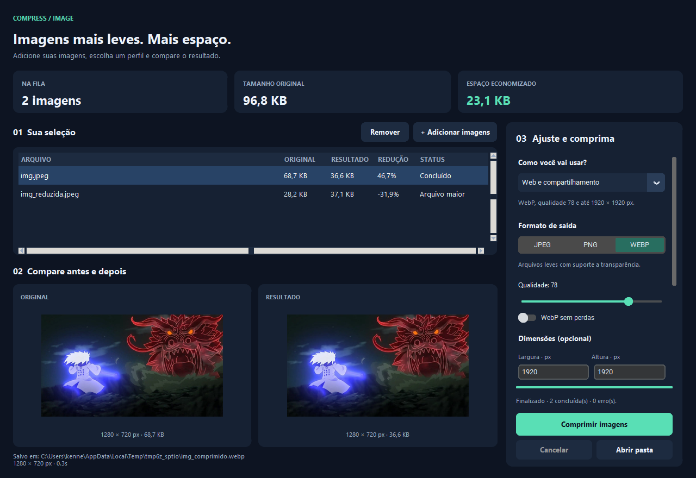
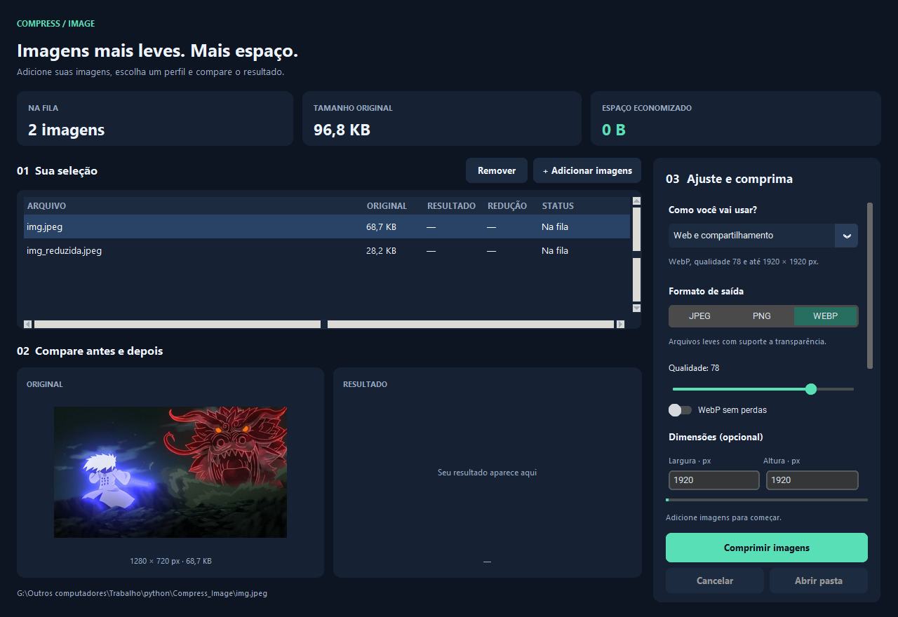

# Compress Image

Compressor desktop de imagens em português, com processamento em lote, perfis prontos e comparação entre original e resultado. Usa Pillow no processamento e CustomTkinter na interface.



## Instalação e execução

Python 3.11 ou superior com Tkinter.

```bash
python -m pip install -r requirements.txt
python compress_image.py
```

No Debian/Ubuntu, Tkinter pode exigir o pacote de sistema `python3-tk`.

## Como usar

1. Clique em **Adicionar imagens**; selecione um ou vários arquivos. O atalho **Ctrl+O** também abre a seleção.
2. Escolha um perfil e, se necessário, ajuste formato, qualidade, dimensões e limite em KB.
3. Escolha uma pasta de destino ou deixe o campo vazio para salvar ao lado de cada original.
4. Clique em **Comprimir imagens**.
5. Selecione uma linha para comparar original e resultado, conferir tamanhos e consultar detalhes.
6. Use **Abrir pasta** para acessar o último resultado.

A tabela mostra o status de cada arquivo. Um erro não interrompe os seguintes. **Cancelar** interrompe o trabalho entre etapas; uma codificação Pillow em andamento termina antes do cancelamento ser atendido. Resultados já concluídos são mantidos.

As prévias mostram os arquivos original e exportado; mudanças nos ajustes aparecem na comparação depois de comprimir novamente. O fundo quadriculado indica transparência.

## Imagens do programa

### Seleção de imagens e ajustes

Adicione os arquivos à fila e escolha um perfil. A prévia permite conferir o original antes de iniciar a compressão.



### Resultado e comparação

Depois de processar, a tabela mostra os tamanhos e a redução de cada arquivo. Selecione uma linha para comparar o original com o resultado lado a lado.


## Perfis

| Perfil | Configuração inicial |
|---|---|
| Equilibrado | JPEG, qualidade 85, dimensões originais |
| Web e compartilhamento | WebP, qualidade 78, até 1920 × 1920 px |
| Alta qualidade | JPEG, qualidade 95, dimensões originais |
| Sem perdas | PNG, sem quantização de cores |

Os ajustes do perfil podem ser personalizados. Em WebP, também é possível ativar o modo **sem perdas**. PNG sempre preserva as cores dos pixels, sem conversão automática para paleta. O controle de qualidade fica desativado nos modos sem perdas.

O perfil Equilibrado usa JPEG; para preservar transparência, escolha PNG ou WebP. JPEG aplica um fundo branco nas áreas transparentes.

## Formatos e dimensões

Entradas incluem JPEG, PNG, WebP, BMP, GIF estático, TIFF de uma página, ICO, PPM, PGM, PCX e TGA, conforme suporte do Pillow instalado. Imagens animadas e documentos com várias páginas são recusados para evitar perder quadros silenciosamente.

Saídas: **JPEG**, **PNG** e **WebP**. Com **Manter proporção**, largura e altura definem uma caixa máxima e a imagem nunca é ampliada. Preencher apenas uma dimensão também funciona. Desativar a opção permite dimensões exatas, incluindo ampliação ou distorção.

O limite em KB está disponível para JPEG e WebP com perdas. A busca ajusta primeiro a qualidade; se necessário, reduz também a resolução. As dimensões finais são mostradas no resultado. Um limite impossível gera erro, sem publicar uma saída parcial.

## Qualidade e proteção dos arquivos

- Originais nunca são sobrescritos, inclusive com `--force`.
- Nomes automáticos: `foto_comprimido.jpg`, `foto_comprimido_2.jpg`, etc.
- Arquivos existentes e nomes iguais vindos de pastas diferentes são protegidos.
- O resultado é gravado em um temporário no destino e publicado somente quando estiver completo.
- A orientação EXIF é aplicada antes de redimensionar; não há ajustes automáticos de contraste ou nitidez.
- Perfis ICC são preservados; imagens CMYK com perfil passam por conversão para sRGB.
- Saídas recodificadas não recebem EXIF/GPS. Quando o original é mantido por não haver redução, seus metadados também são mantidos.
- Se a imagem continuar no mesmo formato e nas mesmas dimensões, sem correção de orientação, um resultado maior é substituído por uma cópia do original, respeitando o limite em KB.
- Conversões e redimensionamentos solicitados são mantidos mesmo se aumentarem o arquivo; a tabela informa **Arquivo maior**.

A redução depende do conteúdo e da compressão já existente. “Sem perdas” se refere aos pixels: redimensionar, aplicar orientação ou converter espaços de cor continua sendo uma transformação.

## Linha de comando

Sem argumentos, abre a interface. Para comprimir pelo terminal:

```bash
python compress_image.py foto.png foto.webp -p web
python compress_image.py foto.jpg menor.jpg --width 1280 --max-size-kb 200
python compress_image.py logo.png logo-otimizado.png -p lossless
python compress_image.py foto.jpg resultado.jpg --quality 90 --force
python compress_image.py --help
```

A extensão da saída deve corresponder ao formato do perfil ou ao argumento `--format`. Os códigos de saída são 0 para sucesso, 1 para falhas de processamento e 2 para argumentos inválidos.

## Organização e reutilização

Este projeto é independente e dedicado à compressão de imagens. O motor e a interface ficam separados para facilitar a manutenção e o reaproveitamento em outros projetos:

| Arquivo | Responsabilidade |
|---|---|
| `compress_image.py` | Entrada desktop e CLI; importação do motor sem carregar a interface |
| `image_engine.py` | Perfis, configurações, leitura, compressão e API importável |
| `image_gui.py` | Interface e fila; painel incorporável a outra janela |
| `compression_common.py` | Erros, resultado base, tamanhos e geração de nomes |
| `tests/` | Regressões do motor e fluxo real da interface |

A API pode ser importada sem abrir a interface:

```python
from image_engine import compress_image

result = compress_image("foto.png", "foto.webp", preset="web")
print(result.output_path, result.reduction_percent)
```

O painel de imagens também pode ser incorporado a outra aplicação sem criar uma segunda janela ou outro `mainloop`.

Uma futura aplicação reunindo imagens e PDFs será desenvolvida em um projeto separado. As [notas de reutilização](docs/INTEGRATION.md) registram os contratos que podem ser aproveitados lá.

## Verificação

```bash
python -m unittest discover -s tests -v
```

Os testes geram imagens em pastas temporárias. Cobrem PNG sem perdas, WebP, transparência, orientação EXIF, perfil ICC, limites viáveis e impossíveis, preservação dos originais, colisões de nomes, cancelamento, CLI e execução da fila com erros e prévias. Os testes gráficos são ignorados quando não há ambiente gráfico disponível.

Desenvolvido por [Kennedh](https://github.com/Kennedh).
